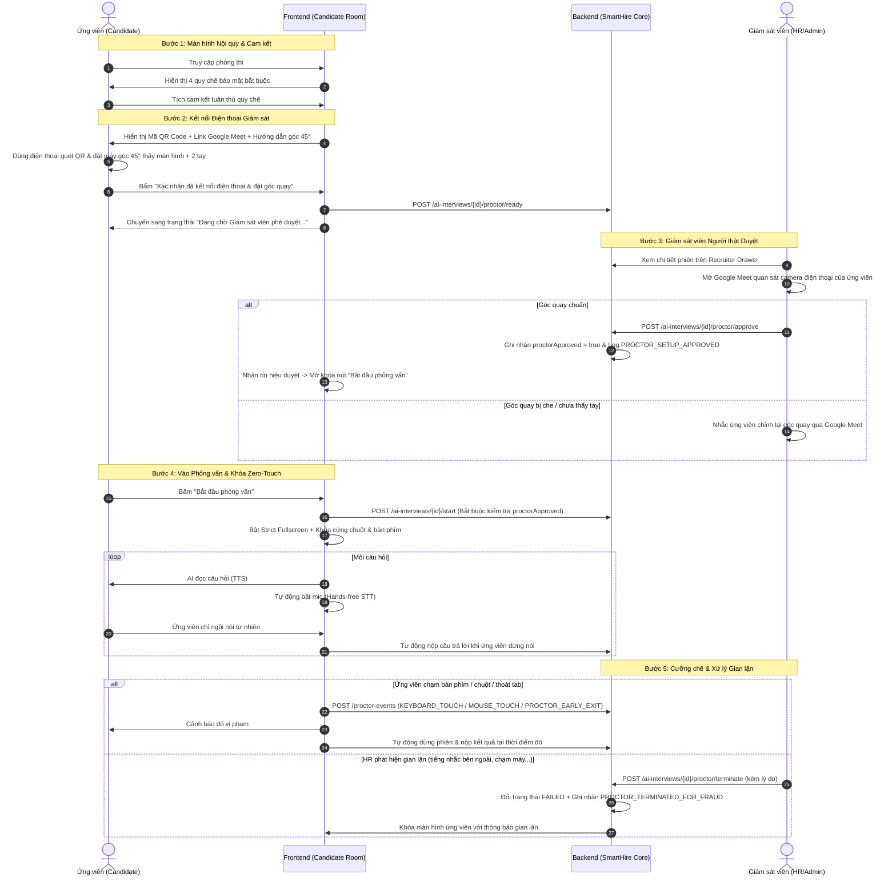

# Cơ chế Giám sát Phỏng vấn AI & Chống Gian lận (Dual-Device & Zero-Touch Proctoring)

## 1. Mục đích chức năng
Nâng cấp và siết chặt cơ chế bảo mật cho các phiên **AI Interview** trong nền tảng SmartHire-AI, ngăn chặn triệt để các hành vi gian lận công nghệ cao:
1. **Khóa thao tác thiết bị (Zero-Touch Lockdown):** Chặn hoàn toàn chuột và bàn phím sau khi phiên bắt đầu; ứng viên chỉ ngồi nói tự nhiên, không thể dùng phím tắt hoặc chuột để tra cứu hay gọi công cụ AI bên ngoài (ChatGPT, Claude, extension).
2. **Giám sát qua thiết bị thứ hai (Secondary Mobile Device Proctoring):** Yêu cầu ứng viên quét mã QR tham gia phòng họp trực tuyến (Google Meet) bằng điện thoại, đặt góc nghiêng 45° bao quát: toàn bộ màn hình máy tính, tư thế ngồi và 2 bàn tay.
3. **Nhân sự giám sát người thật (Human Proctor Approval & Control Gate):** Giám sát viên (HR/Admin) trực tiếp theo dõi qua camera điện thoại; chỉ khi kiểm tra góc quay đạt chuẩn và bấm xác nhận "OK" thì phỏng vấn mới được bắt đầu. Giám sát viên có quyền dừng phiên ngay lập tức nếu phát hiện gian lận.
4. **Hiển thị nội quy bắt buộc:** Màn hình nội quy rõ ràng, giải thích cặn kẽ các lệnh cấm và hướng dẫn đặt góc quay chuẩn trước khi vào phòng.
5. **Cơ chế thoát/đóng ứng dụng:** Nếu ứng viên cố tình chạm/thoát phỏng vấn trước giờ hoặc rời khỏi fullscreen/tab thi, hệ thống sẽ dừng phiên và ghi nhận kết quả tại thời điểm đó.

---

## 2. Actor
- **Ứng viên (Candidate):** Đọc nội quy, quét mã QR tham gia Google Meet trên điện thoại, cố định góc máy, chờ HR duyệt, thực hiện phỏng vấn 100% bằng giọng nói (rảnh tay, không chạm thiết bị).
- **Giám sát viên (Recruiter / HR / Tenant Admin):** Vào link Google Meet giám sát trên Portal, kiểm tra góc quay của ứng viên, bấm "Xác nhận góc quay đạt chuẩn (Phê duyệt)" để mở quyền phỏng vấn; có quyền bấm "Dừng phiên khẩn cấp (Phát hiện gian lận)" trong suốt phiên.
- **Hệ thống AI Interview:** Tự động khóa phím & chuột, đàm thoại giọng nói thông minh (TTS + STT + VAD rảnh tay), phát hiện chạm thiết bị / thoát tab, dừng phiên và chấm điểm tự động.

---

## 3. Luồng hoạt động (Workflow)

---

## 4. Business Rules
1. **Quy tắc Phê duyệt góc quay:**
   - Ứng viên không thể gọi `POST /start` nếu `proctorApproved != true` (server trả về mã lỗi `AI_PROCTOR_NOT_APPROVED`).
   - Nút "Bắt đầu phỏng vấn" phía Frontend bị khóa (disabled) kèm icon ổ khóa khi chưa được duyệt.
2. **Quy tắc Khóa Zero-Touch:**
   - Mọi sự kiện phím (`keydown`, `keyup`) và chuột (`mousedown`, `click`, `wheel`) đều bị chặn ở capture phase.
   - Phát hiện chạm thiết bị $\rightarrow$ tăng bộ đếm vi phạm và cảnh báo đỏ. Tái phạm quá 3 lần $\rightarrow$ tự động dừng phiên ngay lập tức.
3. **Quy tắc Thoát sớm (Early Exit):**
   - Bất kỳ hành vi thoát toàn màn hình (`FULLSCREEN_EXIT`), ẩn tab hoặc chuyển cửa sổ (`PAGE_HIDDEN`, `WINDOW_BLUR`) trong lúc đang phỏng vấn $\rightarrow$ kích hoạt `PROCTOR_EARLY_EXIT`, tự động nộp bài và kết thúc phiên tại thời điểm đó.
4. **Quy tắc Quyền hạn Giám sát viên (HR Override):**
   - Giám sát viên có quyền dừng phiên bất kỳ lúc nào khi phiên đang `IN_PROGRESS`.
   - Kết quả phiên bị chuyển sang `FAILED` kèm lý do vi phạm do Giám sát viên lựa chọn.

---

## 5. API Liên quan

| Phương thức | Endpoint | Actor | Mô tả |
|---|---|---|---|
| `POST` | `/api/tenant/ai-interviews/{id}/proctor/ready` | Candidate | Ứng viên gửi tín hiệu đã quét QR và đặt máy |
| `POST` | `/api/tenant/ai-interviews/{id}/proctor/approve` | Staff (HR/Admin) | Xác nhận góc quay đạt chuẩn (Phê duyệt) |
| `POST` | `/api/tenant/ai-interviews/{id}/proctor/unapprove` | Staff (HR/Admin) | Hủy phê duyệt góc quay (yêu cầu đặt lại) |
| `POST` | `/api/tenant/ai-interviews/{id}/proctor/meet-link` | Staff (HR/Admin) | Cập nhật đường dẫn phòng Google Meet |
| `POST` | `/api/tenant/ai-interviews/{id}/proctor/terminate` | Staff (HR/Admin) | Dừng phiên khẩn cấp do phát hiện gian lận |
| `POST` | `/api/tenant/ai-interviews/{id}/proctor-events` | Candidate | Gửi sự kiện vi phạm (`KEYBOARD_TOUCH`, `MOUSE_TOUCH`, `PROCTOR_EARLY_EXIT`,...) |
| `POST` | `/api/tenant/ai-interviews/{id}/start` | Candidate | Bắt đầu phỏng vấn (yêu cầu `proctorApproved == true`) |

---

## 6. Database & Dữ liệu
- Lưu thông tin giám sát trong `context_snapshot_json` của bảng `ai_interviews`:
  - `proctorMeetUrl`: Đường dẫn Google Meet giám sát (chuẩn hóa mặc định: `https://meet.google.com/smh-proctor-{id}`).
  - `proctorApproved`: Cờ boolean xác nhận góc quay đã được HR duyệt.
  - `proctorApprovedAt`: Thời điểm duyệt.
  - `proctorTerminated`: Cờ boolean đánh dấu phiên bị HR chấm dứt do gian lận.
  - `proctorTerminationReason`: Lý do vi phạm cụ thể.
- Lịch sử vi phạm và giám sát được ghi nhận chi tiết vào bảng `ai_interview_logs`:
  - `PROCTOR_CANDIDATE_READY`: Ứng viên đã sẵn sàng camera điện thoại.
  - `PROCTOR_SETUP_APPROVED`: Giám sát viên phê duyệt góc quay.
  - `PROCTOR_KEYBOARD_TOUCH`: Phát hiện chạm bàn phím.
  - `PROCTOR_MOUSE_TOUCH`: Phát hiện chạm chuột.
  - `PROCTOR_EARLY_EXIT`: Thoát màn hình thi sớm.
  - `PROCTOR_TERMINATED_FOR_FRAUD`: Giám sát viên dừng phiên do phát hiện gian lận.

---

## 7. UI Mockup & Thành phần Giao diện
1. **Ứng viên:**
   - `ProctoringPreFlight.tsx`: Màn hình 3 bước gồm Nội quy cam kết, QR Code mở Google Meet + Sơ đồ hướng dẫn góc 45°, và Khối chờ Giám sát viên phê duyệt.
   - `ProctoredInterviewGuard.tsx`: Lớp bảo vệ Zero-Touch toàn màn hình, Floating Pill báo trạng thái khóa phím/chuột, hộp thoại cảnh báo vi phạm đỏ nhấp nháy.
   - `ConversationRoom.tsx`: Tự động thu âm sau khi AI nói xong và tự động gửi bài khi ngưng nói (Hands-free 100%).
2. **Nhà tuyển dụng (HR/Admin):**
   - `LiveProctoringPanel.tsx` tích hợp trong `AiInterviewDetailDrawer`: Hiển thị link phòng Google Meet, nút xem camera điện thoại ứng viên, nút xanh "Xác nhận góc quay đạt chuẩn (Phê duyệt)", và nút đỏ "Dừng phiên phỏng vấn (Phát hiện gian lận)" kèm modal chọn lý do vi phạm.

---

## 8. Trạng thái
- **Trạng thái:** `Done`

